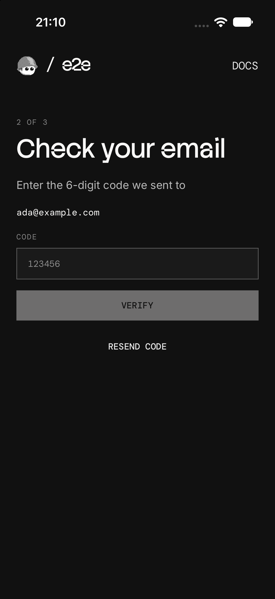

# e2e-onboarding

An Expo onboarding (an email code, then the notification prompt) tested end to end on iOS and Android with [e2e](https://www.npmjs.com/package/e2e).



## How it works

- **Email** (`src/app/index.tsx`): `POST /api/send-code` emails a 6-digit code with nodemailer.
- **Code** (`src/app/code.tsx`): `POST /api/verify-code` checks it. Resend code replaces the first one.
- **Notifications** (`src/app/notifications.tsx`): the OS asks; either answer leads to the welcome screen.

The API routes are Expo Router routes, served by Metro in development. There's no database: the server signs each code into a token the app keeps. Progress is saved on the device, so a restart reopens the same step. Emails go to [Mailpit](https://mailpit.axllent.org), a local inbox.

## Getting started

You need Node 22.22.3+ and Xcode with an iOS simulator, or the Android SDK with an emulator ([Expo's setup guide](https://docs.expo.dev/get-started/set-up-your-environment/)).

```bash
npm install
brew install mailpit && brew services start mailpit
npm run ios        # or: npm run android
```

`npm run ios` builds the app, installs it on the simulator, and starts Metro. Codes show up in Mailpit at [localhost:8025](http://localhost:8025). The app needs a native build, so it doesn't run in Expo Go.

## End-to-end tests

`tests/onboarding.e2e.ts` runs the same tests on iOS and Android. Each one starts on a fresh install with a new address and checks Mailpit's API for exactly one email per send. The agent gets the code the way a person would: `read_inbox`, a [project tool](https://e2e.tester.army/docs/tools) in `tests/mailpit.ts`, reads the inbox for it. The OS's prompt is answered on screen.

| Test | Expects |
| --- | --- |
| Finishes onboarding with the code from the email (agent) | Welcome, notifications On |
| A wrong code shows an error | "That code isn't right." |
| Resending replaces the first code (agent) | The first code fails, the newest works |
| Denying notifications still finishes | Welcome, notifications Off |
| Closing the app on the code step picks up there | Back on the code step after a cold launch |

The agent tests need a [Vercel AI Gateway](https://vercel.com/docs/ai-gateway) key: copy `.env.example` to `.env.local` and set `AI_GATEWAY_API_KEY`. Without it they skip; without Mailpit, all of them skip. With the app installed, run:

```bash
npx e2e run --target ios
npx e2e run --target android
```

Without `--target`, both run, in about 3 minutes and under a cent. The runner starts Metro if it isn't running.

## Scripts

| Command            | Description                         |
| ------------------ | ----------------------------------- |
| `npm start`        | Start Metro                         |
| `npm run ios`      | Build and run the app on iOS        |
| `npm run android`  | Build and run the app on Android    |
| `npm run lint`     | Run ESLint                          |
| `npm run test:e2e` | Run the e2e tests on both platforms |
